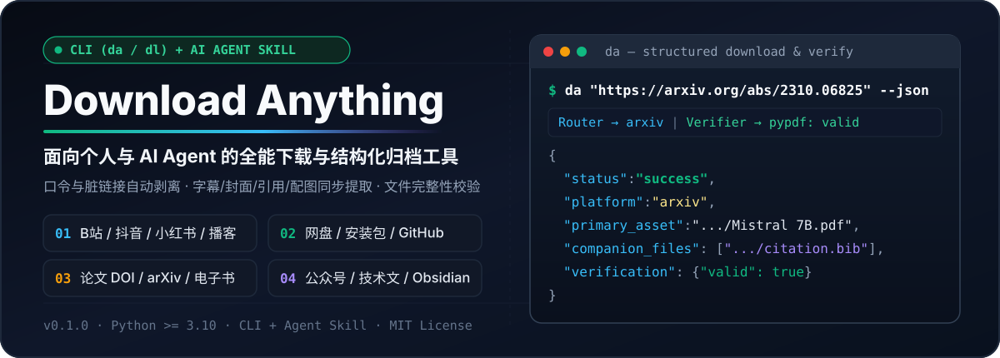
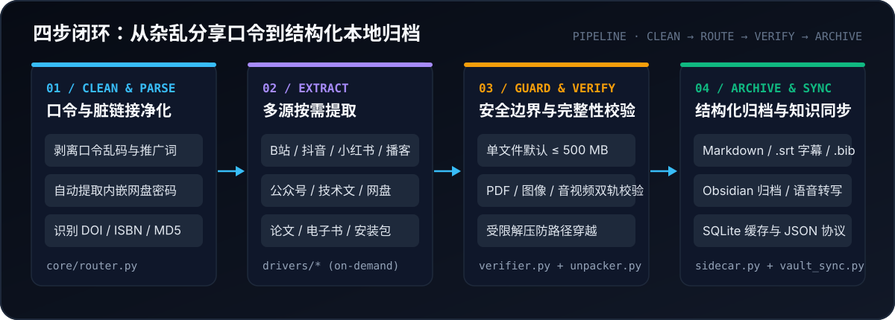

<p align="center">
  
</p>

# Download Anything (DA)

**Download Anything (`da` / `dl`)** 是一个面向个人与 AI Agent 的数字微资产提取与本地归档工具，提供 **命令行 CLI** 与 **Agent Skill** 双入口。无论是日常刷到的视频与多图笔记、长播客、加密音频，还是公众号长文、技术博客、网盘分享小文件、学术论文、电子书、GitHub 单文件或应用安装包，丢给它即可完成**脏链接清洗、提取下载、格式级校验与本地知识库归档**。

## 支持的能力全景（三层结构）

完整输入输出规范见 [`skills/download-anything/references/platforms.md`](./skills/download-anything/references/platforms.md)。

### 1. 视频下载
- **哔哩哔哩（B站）**
  - 解析标准视频链接、移动端分享口令与 `b23.tv` 短链
  - 下载声画同步 `.mp4` 视频、高清封面 `cover.jpg` 及 UP 主互动数据
  - 自动获取 CC / AI 字幕并转换为标准 `.srt` 时间轴字幕文件
- **小红书**
  - 解析网页链接与 App 分享短链（`xhslink.com` / `xhslink.cn`）
  - 下载视频笔记 `.mp4`，完整保留标题、正文、话题标签与封面
- **YouTube**
  - 解析视频与短链，自动选轨合并声画同步 `.mp4` 并保存封面与简介
- **X (Twitter)**
  - 下载推文视频（自动选轨合并高画质 `.mp4`），同步保存推文正文与封面
- **微博**
  - 免手动导入登录态，直接下载微博视频 `.mp4` 并归档微博正文
- **Instagram Reels**
  - 下载 Reels 短视频（自动合并音视频轨输出 `.mp4`），保留描述与封面
- **TikTok**
  - 下载公开视频 `.mp4`，保留视频文案、标签与创作者信息
- **通用流媒体（HLS / m3u8）**
  - 支持标准 `.m3u8` 视频流分片拉取、自动合并与 `ffprobe` 轨道校验

### 2. 图片与图文图集
- **小红书多图与实况图（LivePhoto）**
  - 按原笔记顺序批量下载全部高清 `.jpg` 图片
  - 实况图笔记自动提取每一张图片配套的 `.mov` 动态视频流
- **X (Twitter) 多图**
  - 自动过滤转推与回复干扰，按顺序提取推文内全部原图级（`:orig`）图片并归档正文
- **微博多图（九宫格 / 图集）**
  - 免登录提取微博全部高清大图，按顺序落盘并保存正文说明
- **Instagram 多图（Carousel）**
  - 配合本机授权会话 Cookie，按顺序完整下载多图帖全部高清图片

### 3. 音频、播客与音乐
- **小宇宙播客**
  - 下载单集原档音频（`.m4a` / `.mp3`）、单集封面，完整提取节目 Shownotes 与时间轴笔记
- **Apple Podcasts**
  - 解析播客单集链接，下载官方源站原档音频与封面，提取节目简介与发布信息
- **哔哩哔哩纯音轨**
  - 通过 `-a` 参数直接提取视频纯音轨（`.m4a` / `.mp3`）
- **网易云音乐**
  - 公开曲目直接下载 `.mp3` 与专辑封面，自动提取同步滚动歌词（`.lrc`）
  - 受限曲目自动提取原版封面、`.lrc` 歌词与元数据，并通过公开音源匹配下载完整 `.mp3`
- **Spotify & Apple Music**
  - 提取官方曲目元数据与超清专辑封面（Apple Music 支持 `3000×3000`），通过公开音源匹配下载 `.mp3`
- **本地加密与无损音频转换**
  - **网易云 `.ncm` 解密**：还原为标准 `.mp3`，保留内嵌专辑封面与歌曲/歌手/专辑 ID3 标签
  - **无损 `.flac` 转码**：转换为标准 `320kbps` `.mp3`（保留原文件）
- **云端语音转写（`--transcribe`）**
  - 配置 `GROQ_API_KEY`、`OPENAI_API_KEY` 或 `SILICONFLOW_KEY` 后，可将播客或音轨转写为带分段时间戳的 `.transcript.md` 文字稿

### 4. 文档、文章与知识库归档
- **微信公众号文章**
  - 提取完整正文转换为干净 Markdown（`article.md`）
  - 自动绕过微信防盗链，将正文内全部插图下载至本地并重写为相对路径引用
- **主流技术社区与专栏文章**
  - 支持知乎、掘金、CSDN、博客园、Medium、Substack、少数派、简书、SegmentFault、开源中国、V2EX
  - 自动剥离页面导航与广告噪声，将正文代码块与配图本地化归档为 Markdown
- **Obsidian 知识库同步（`--vault`）**
  - 将下载的 Markdown、配图与伴生资产同步至本地 Obsidian Vault，自动注入 YAML frontmatter
- **Notion 数据库同步（`--notion`）**
  - 配置 `NOTION_API_KEY` 与 `NOTION_DATABASE_ID` 后，自动在 Notion 数据库创建归档页面

### 5. 学术论文与电子书
- **arXiv 学术论文**
  - 支持 `arxiv.org/abs/...`、`arxiv.org/pdf/...` 或纯编号（如 `2310.06825`）
  - 下载官方全文 `.pdf`，提取标题、作者与摘要，自动生成 `citation.bib` 引用文件
- **DOI 开放获取论文**
  - 识别标准 DOI（如 `10.1186/...`），查询 Crossref 与 Unpaywall 下载开放获取全文 `.pdf` 并生成 `citation.bib`
- **电子书（ISBN / MD5）**
  - 直接输入 10/13 位 ISBN（如 `9780141439518`）或 32 位 MD5，自动检索镜像下载 `.epub` / `.pdf` 电子书并执行容器结构校验

### 6. 网盘分享文件
- **百度网盘**
  - 自动识别分享文本中的链接与 4 位提取码，支持 `--check` 预检文件大小，结合本机登录态下载分享原文件（ZIP / TAR 归档默认自动安全解压）
- **夸克网盘**
  - 自动读取登录态、递归查找分享子目录文件、转存至任务专属临时目录 `_da_temp_<uuid>`，下载完成后自动清理云端临时目录

### 7. 代码与开发资产
- **GitHub 单文件**
  - 支持 `github.com/<owner>/<repo>/blob/<branch>/<path>` 链接
  - 免 `git clone` 整个仓库，直接按指定分支或 Commit 精准拉取目标代码、配置或文档原文件

### 8. 应用与软件安装包
- **微软商店离线安装包（Microsoft Store）**
  - 输入商店链接或 12 位 Product ID（如 `9n0dx20hk701`），直接从微软官方 CDN 下载 `.msixbundle` / `.appxbundle` 离线安装包及安装指引
- **安卓应用安装包（Android APK）**
  - 输入 Google Play 链接、APKPure/Aptoide 链接或应用包名（如 `com.spotify.music`），自动检索镜像下载 `.apk` 安装包并生成 ADB 安装命令

## 快速上手

可以直接把分享文本、链接、DOI、ISBN、MD5 或本地 NCM、FLAC 文件交给 `da`：

```bash
# 1. 下载 B站视频（自动保存封面与 .srt 字幕）
da "https://www.bilibili.com/video/BV1xx411c7mD" --json

# 2. 粘贴带提取码的百度或夸克网盘分享文本
da "通过网盘分享的文件：资料包.zip 链接: https://pan.baidu.com/s/1xxxx 提取码: a1b2" --json

# 3. 下载 arXiv 或开放获取 DOI 学术论文（自动生成 citation.bib）
da "https://arxiv.org/abs/2310.06825" --json

# 4. 下载小宇宙或 Apple Podcasts 播客单集（含 Shownotes 与封面）
da "https://www.xiaoyuzhoufm.com/episode/65f..." --json

# 5. 将公众号或技术社区文章与配图同步至本地 Obsidian 知识库
da "公众号文章链接" --vault ~/Documents/MyVault --json

# 6. 按 ISBN 或 MD5 下载电子书
da "9780141439518" --json
da "51860b9694a6d153c4c305dcf3b9e10d" --json

# 7. 本地 NCM 解密或 FLAC 转 320kbps MP3
da "/path/to/music.ncm" --json
```

## 工作机制与架构设计

<p align="center">
  
</p>

DA 将一次提取任务拆解为四个可验证阶段：

1. **脏输入净化与智能路由（`core/router.py`）**：自动剔除分享文本中的推广词与表情符号，提取标准 URL 与内嵌密码（`提取码` / `pwd`），并识别学术 DOI、ISBN 与 MD5。
2. **按需分发（`drivers/*`）**：按目标类型匹配专属驱动；作为 AI Skill 加载时仅暴露轻量路由描述，避免全量上下文占用。
3. **安全边界与格式级校验（`core/verifier.py` & `core/unpacker.py`）**：
   - 默认单文件下载上限 `500 MB`（可通过 `--max-mb N` 调整）。
   - 针对 PDF（`pypdf`）、EPUB、图片（`Pillow`）、压缩包（`zipfile`）执行格式检查；借助 `ffprobe` 扫描音视频轨道与可读数据包（`media-structure` 级别）。
   - 支持 `ZIP` / `TAR` 归档自动解压与路径边界检查（总量上限 `500 MB` / `10,000` 个成员），可通过 `--no-unzip` 保留原压缩包。
4. **伴生资产与知识库归档（`core/sidecar.py` & `core/vault_sync.py`）**：主文件落盘后按需生成 `.info.json`、Markdown 正文、`.srt` 字幕、`.lrc` 歌词或 `citation.bib`，支持同步至 Obsidian / Notion 及云端 Whisper 语音转写（`--transcribe`），并通过 SQLite 本地索引（`~/.download-anything/index.db`）实现缓存复用。

## 安装、升级与卸载

### 环境要求

- **Python**：`3.10` 或更高版本。安装脚本会优先查找本机已有的 Python 3.10+，未找到时可按提示通过 `uv` 准备独立的 Python 3.12（非交互环境加 `--yes`）。
- **FFmpeg（音视频组件）**：用于 `ffprobe` 媒体结构校验、`ffmpeg` 抽轨与转码、HLS/DASH 流合并。

### 从源码或发布包安装

从源码目录或解压后的 Skill 发布包安装到独立虚拟环境（默认位于 `~/.download-anything/venv`）：

```bash
python3 skills/download-anything/scripts/install.py
~/.download-anything/venv/bin/da doctor --json
```

- **配置 PATH**：将 `~/.download-anything/venv/bin`（Windows 为 `%USERPROFILE%\.download-anything\venv\Scripts`）加入系统 `PATH` 后，即可直接调用 `da` 或 `dl`。
- **依赖源与镜像**：安装依赖和 `da doctor --fix` 默认优先连接官方 PyPI，超时后自动切换清华、阿里云镜像；也可通过 `DA_PIP_INDEX_URL` 指定自定义源。
- **升级或修复依赖**：重新运行 `install.py` 即可升级或重建环境（可通过 `--venv /自定义路径` 指定位置）；CLI 已安装时也可运行 `da doctor --fix --json` 自动补齐缺失的 Python 依赖。

### 卸载

删除安装时创建的虚拟环境目录（如 `~/.download-anything/venv`）并移除对应的 `PATH` 配置即可。`~/.download-anything/index.db`（缓存索引）、`~/.download-anything/credentials.yaml`（`0600` 权限凭据配置）及已下载文件可按需保留或手动清理。

## 常用参数与自动化结果协议

详细 CLI 规范见 [`skills/download-anything/references/cli.md`](./skills/download-anything/references/cli.md)。

### JSON 状态与退出码协议

| `status` 字段 | 单任务退出码 | 含义 |
| :--- | :---: | :--- |
| `success` | `0` | 主文件通过格式校验，伴生附件及后续同步步骤均已完成 |
| `cached` | `0` | 命中本地缓存记录（`cached-existence`），直接复用已有文件 |
| `dry_run` | `0` | 完成 `--check` 元数据预检 |
| `partial` | `2` | 主文件已保存，部分伴生附件、同步或临时目录清理未完成；详见 `warnings` 与 `operations` |
| `error` | `1` | 下载或主文件校验失败；详见 `error_type` 与 `message` |

- **批量任务退出码**：批量结果（`-i links.txt`）若包含 `partial` 项则返回 `2`；否则至少一项成功返回 `0`，全部失败返回 `1`。
- **校验级别**：`verification.details.level` 标识实际执行的检查级别（如音视频 `media-structure`、常规格式 `basic`、缓存复用 `cached-existence`）。

## 开发与打包

```bash
# 安装开发依赖
uv pip install -e '.[dev]'

# 运行单元测试与工程回归
.venv/bin/python -m pytest tests -q

# 构建 dist/ 下的 CLI wheel 与完整 Skill 发布 ZIP
python3 scripts/build_release.py
```

## 许可证

本项目基于 [MIT License](./LICENSE) 开源。
